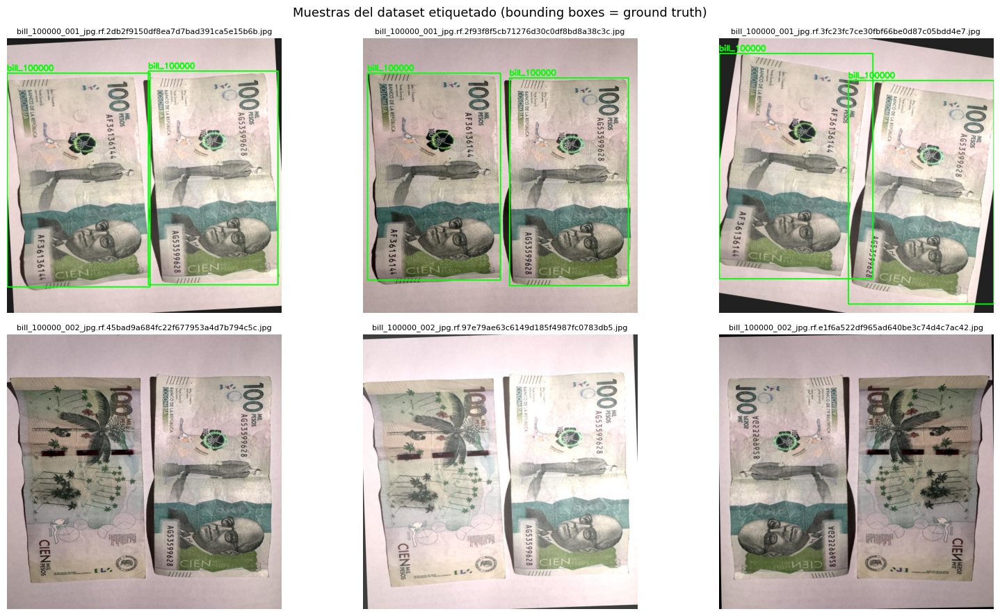
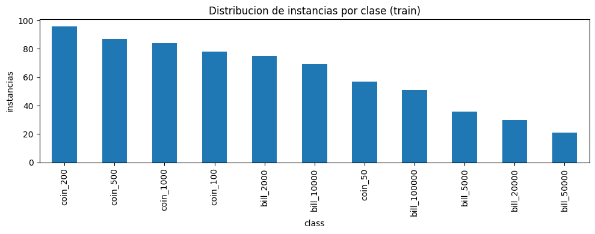
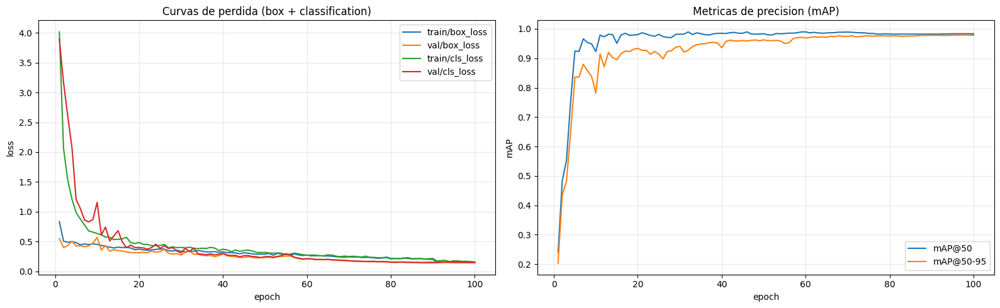
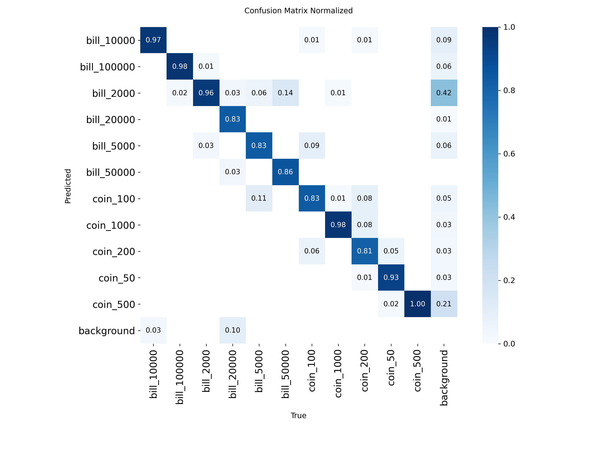
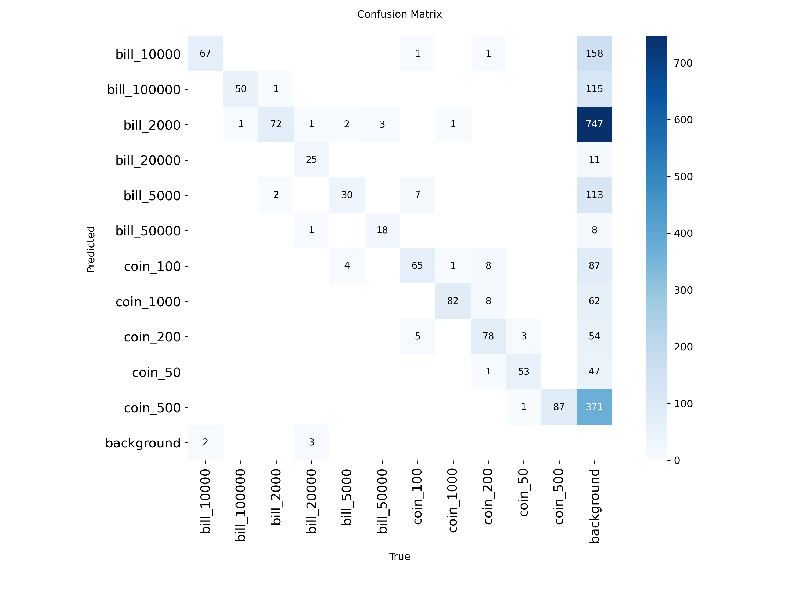
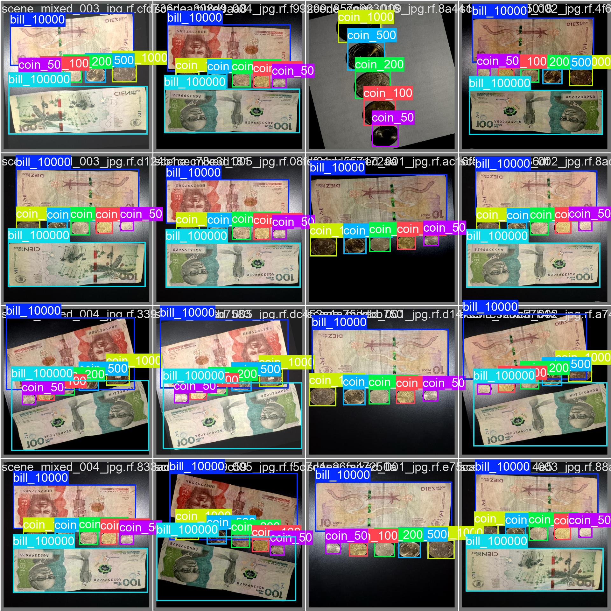
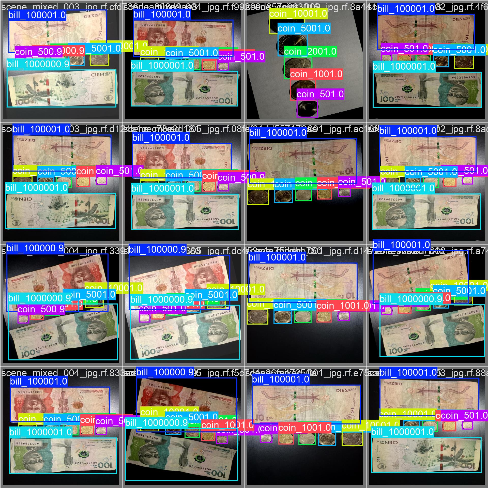
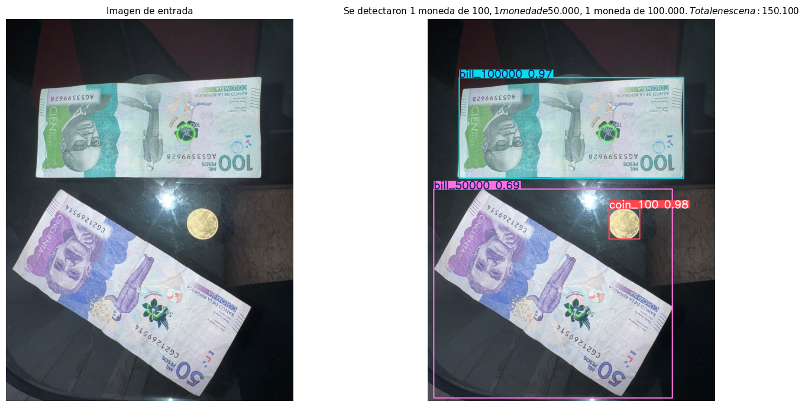

# Detección, Clasificación y Cuantificación de Divisas Colombianas con YOLO11

Sistema de visión artificial **end-to-end** capaz de **reconocer, clasificar y cuantificar** el valor
monetario de monedas y billetes colombianos presentes en una escena, mediante *transfer learning*
sobre **YOLO11**.

Pipeline: **dataset propio** → **entrenamiento** → **validación** → **inferencia + cuantificación**.

| Elemento | Detalle |
|---|---|
| Modelo base | `yolo11n.pt` (pesos COCO pre-entrenados) |
| Framework | [Ultralytics](https://docs.ultralytics.com/) |
| Dataset | Roboflow — workspace `jhonns-workspace-aebuy`, proyecto `deteccion_divisas`, versión 1 |
| Formato de export | YOLOv11 (`.txt` normalizado `class cx cy w h`) |
| Clases | 11 denominaciones (`coin_50` … `bill_100000`) |
| Imágenes anotadas | 96 originales (68 de clase única + 28 escenas) → 288 en train tras aumentos |
| Instancias de entrenamiento | 684 |
| Resultado | mAP@50 **0.9835** · mAP@50-95 **0.9793** · Precision **0.9972** · Recall **0.9825** |
| Entorno de entrenamiento | Google Colab (GPU T4) |

---

## Ciclo de vida del proyecto

```
1. CAPTURA           2. ANOTACIÓN          3. ENTRENAMIENTO        4. VALIDACIÓN        5. INFERENCIA + CUANTIFICACIÓN
   ┌──────────┐        ┌──────────┐          ┌──────────┐            ┌──────────┐         ┌──────────────────┐
   │ Fotos    │  --->  │ Roboflow │   --->   │ YOLO11   │   --->     │ mAP /    │  --->   │ Cajas + conteo + │
   │ (móvil)  │        │ bounding │          │ transfer │            │ matriz de│         │ sumatoria ($)    │
   │          │        │ boxes    │          │ learning │            │ confusión│         │                  │
   └──────────┘        └──────────┘          └──────────┘            └──────────┘         └──────────────────┘
    96 imgs             11 clases             100 epochs              best.pt             "Total: $150.100"
```

---

## 1. Dataset etiquetado

### 1.1 Protocolo de captura

Fotografías tomadas con cámara de móvil sobre una **superficie homogénea** (fondo mate, sin texturas),
cubriendo tres variaciones espaciales obligatorias:

| Variación | Descripción | Propósito |
|---|---|---|
| Aislada | Una sola divisa centrada | Clase limpia, base de *features* |
| Agrupada | Varias divisas separadas en la misma escena | Multi-instancia y distintos tamaños |
| Oclusión parcial | Divisas tocándose / solapándose | Robustez ante bordes compartidos |

### 1.2 Ingeniería de iluminación (experimentación óptica)

El metal es **altamente reflectivo**, por lo que la iluminación fue la variable crítica del experimento.
Se capturaron dos regímenes:

| Régimen | Efecto observado |
|---|---|
| **Luz ambiente difusa** | Reflejos planos; el relieve (grabados, numerales) se pierde y las monedas claras se confunden con el fondo. |
| **Luz direccional (flash / fuente lateral)** | Sombras internas que **resaltan el relieve y la topología**. Contra: introduce *hotspots* especulares. |

**Conclusión operativa:** la mayor parte del dataset se capturó con **flash / luz direccional controlada**
y una fracción menor con luz difusa, de forma que el modelo no dependa de un único régimen de luz.
Este hallazgo se documenta en detalle en la sección [Conclusiones técnicas](#7-conclusiones-técnicas).

### 1.3 Composición del dataset

**Captura original: 96 imágenes** (68 de clase única + 28 escenas). Tras los aumentos de Roboflow,
el split de entrenamiento quedó en **288 imágenes / 684 instancias**.

| Clase | Valor nominal | Tipo | Imágenes de clase única | Instancias en train |
|---|---|---:|---:|---:|
| `coin_50` | $50 | Moneda | 5 | 57 |
| `coin_100` | $100 | Moneda | 6 | 78 |
| `coin_200` | $200 | Moneda | 9 | 96 |
| `coin_500` | $500 | Moneda | 7 | 87 |
| `coin_1000` | $1.000 | Moneda | 7 | 84 |
| `bill_2000` | $2.000 | Billete | 7 | 75 |
| `bill_5000` | $5.000 | Billete | 6 | 36 |
| `bill_10000` | $10.000 | Billete | 6 | 69 |
| `bill_20000` | $20.000 | Billete | 6 | 30 |
| `bill_50000` | $50.000 | Billete | 4 | 21 |
| `bill_100000` | $100.000 | Billete | 5 | 51 |
| *Escenas* | — | Monedas / billetes / mixtas | 28 | — |
| **Total** | | | **96** | **684** |

| Grupo de escenas | Cantidad |
|---|---:|
| `scene_coins` (solo monedas) | 9 |
| `scene_bills` (solo billetes) | 14 |
| `scene_mixed` (monedas + billetes) | 5 |

> El inventario completo imagen → clase está en [`coins/dataset/manifest.csv`](coins/dataset/manifest.csv).

### 1.4 Evidencia: dataset etiquetado

Muestras del dataset con las *bounding boxes* de *ground truth* sobrepuestas (salida de la sección 3
del notebook) y distribución de instancias por clase:

| Muestras etiquetadas (ground truth) |
|---|
|  |

| Distribución de instancias por clase |
|---|
|  |

**Preprocesamiento y aumentos aplicados en Roboflow (versión 1):**

| Etapa | Configuración | Motivo |
|---|---|---|
| Preprocesamiento | Auto-Orient + Resize 640×640 | Compatibilidad con YOLO11 y orientación EXIF correcta |
| Aumentos | Flip (H/V), Rotación, Brillo/Exposición | Simular variaciones de ángulo e iluminación |

---

## 2. Gráficas de entrenamiento

**Estrategia:** *transfer learning* desde `yolo11n.pt`. El *backbone* ya conoce bordes, texturas y formas
circulares genéricas; solo se re-entrenan las capas de detección, lo que reduce drásticamente el número
de imágenes necesarias y el tiempo de convergencia frente a entrenar *from scratch*.

### 2.1 Justificación de hiperparámetros

| Hiperparámetro | Valor | Justificación |
|---|---|---|
| `model` | `yolo11n.pt` | Nano: converge rápido en T4 y suficiente para objetos bien definidos. |
| `epochs` | 100 | Dataset pequeño; con `patience=25` se detiene solo si no mejora. |
| `imgsz` | 640 | Estándar YOLO; resuelve el numeral pequeño de las monedas. |
| `batch` | 16 | Ajustado a los ~15 GB de una T4 con nano a 640 px. |
| `optimizer` | `auto` | Ultralytics selecciona AdamW/SGD según el dataset. |
| `lr0` / `lrf` | 0.01 / 0.01 | LR inicial moderado (transfer learning) con decaimiento coseno para afinar al final. |
| `cos_lr` | `True` | Suaviza la convergencia (curva de loss más estable). |
| `patience` | 25 | Early stopping: evita sobreajuste cuando `val/box_loss` empieza a subir. |
| `mosaic` | 1.0 (default) | Aumenta la diversidad de agrupaciones/oclusiones de forma sintética. |
| `pretrained` | `True` | Habilita transfer learning desde COCO. |
| `amp` | `True` | Mixed precision: menos VRAM y ~2× más rápido en GPU. |

### 2.2 Evidencia: curvas de entrenamiento

Las curvas se generan en la sección 4 del notebook (celda de historial) y quedan embebidas como *output*.
Aquí se muestran las curvas reales de la corrida (pérdida de `box`/`cls` para train y val, y evolución
de `mAP@50` / `mAP@50-95`):



**Lectura de las gráficas:** el *overfitting* se detecta cuando `train/*_loss` sigue bajando mientras
`val/*_loss` se estanca o sube. La métrica objetivo es **`mAP50-95(B)`**, el indicador oficial de Ultralytics.
En esta corrida la `box_loss` y la `cls_loss` convergen de forma estable y el `mAP@50` se satura en las
primeras épocas (efecto directo del *transfer learning*); el `mAP@50-95` sigue subiendo más lento porque
refina la precisión de las cajas.

> **Nota de reproducibilidad:** los pesos de la corrida (`best.pt`) y la exportación ONNX se descargan
> desde la sección 7 del notebook (`coins_artifacts.zip`).

---

## 3. Validación y métricas

Se evalúa `best.pt` sobre el split de validación.

> ⚠️ **Limitación metodológica importante:** la exportación de Roboflow **no incluyó los splits `valid`
> ni `test`** (solo `train`). El notebook aplicó un *fallback* que usa `train/images` como validación.
> Por lo tanto, las métricas de esta sección están **calculadas sobre el mismo conjunto de entrenamiento**
> y representan un **escenario optimista (cota superior)**, no una estimación de generalización sobre
> datos no vistos.

### 3.1 Evidencia: matriz de confusión y predicciones de validación

| Matriz de confusión normalizada |
|---|
|  |

| Matriz de confusión (conteos) |
|---|
|  |

Comparación lado a lado entre **ground truth** y **predicción** del modelo en un lote de validación:

| Ground truth (lote 0) | Predicción del modelo (lote 0) |
|---|---|
|  |  |

### 3.2 Resultados (288 imágenes / 684 instancias)

| Métrica | Valor |
|---|---|
| mAP@50 | **0.9835** |
| mAP@50-95 | **0.9793** |
| Precisión media | **0.9972** |
| Recall medio | **0.9825** |

**Métricas por clase** (ordenadas por `mAP@50-95`):

| Clase | Precision | Recall | mAP@50 | mAP@50-95 |
|---|---|---|---|---|
| `coin_200` | 0.998 | 1.000 | 0.995 | 0.995 |
| `bill_50000` | 0.991 | 1.000 | 0.995 | 0.995 |
| `coin_100` | 0.997 | 1.000 | 0.995 | 0.995 |
| `coin_1000` | 0.997 | 1.000 | 0.995 | 0.995 |
| `coin_50` | 0.997 | 1.000 | 0.995 | 0.993 |
| `bill_5000` | 1.000 | 0.993 | 0.995 | 0.993 |
| `bill_100000` | 0.997 | 1.000 | 0.995 | 0.990 |
| `bill_2000` | 1.000 | 0.990 | 0.995 | 0.989 |
| `coin_500` | 1.000 | 0.968 | 0.995 | 0.977 |
| `bill_10000` | 0.997 | 0.957 | 0.969 | 0.958 |
| `bill_20000` | 0.994 | 0.900 | 0.895 | 0.892 |

**Clases más débiles:** `bill_20000` (recall 0.90) y `bill_10000` (recall 0.957) son los billetes con
menos instancias en el dataset (30 y 69), lo que evidencia un **desbalance de clases**: a menor cantidad
de ejemplos, menor recall.

> **Observación técnica (export de Roboflow):** durante la validación Ultralytics emitió el aviso
> `len(segments)=672 != len(boxes)=684`. El export mezcló anotaciones de *detección* y *segmentación*;
> el framework descartó los segmentos y usó solo las cajas, por lo que el modelo resultante es de
> **detección pura**. Para evitar el aviso, exportar exclusivamente como *Object Detection*.

---

## 4. Predicciones visuales + cuantificación monetaria

**Núcleo lógico del reto.** Tras el *forward pass* se extraen del tensor de salida la clase y la confianza
de cada detección y se mapea cada clase a un **valor matemático** (pesos colombianos) para calcular la
sumatoria total de dinero en la escena.

- `result.boxes.cls` → índice de clase predicha
- `result.boxes.conf` → confianza de cada caja
- `result.names` → diccionario `{id: 'coin_100'}`
- `CLASS_VALUES` → tabla de equivalencia clase → valor nominal

```python
CLASS_VALUES = {
    'coin_50': 50,        'coin_100': 100,      'coin_200': 200,
    'coin_500': 500,      'coin_1000': 1000,
    'bill_2000': 2000,    'bill_5000': 5000,    'bill_10000': 10000,
    'bill_20000': 20000,  'bill_50000': 50000,  'bill_100000': 100000,
}

def quantify_money(image_path, model, conf=0.35, iou=0.50, imgsz=640):
    result = model.predict(source=str(image_path), conf=conf, iou=iou,
                           imgsz=imgsz, verbose=False)[0]
    labels = [result.names[int(c)] for c in result.boxes.cls]
    counter = Counter(labels)
    total = sum(CLASS_VALUES.get(lbl, 0) * n for lbl, n in counter.items())
    return result, counter, total
```

### 4.1 Evidencia: predicción con cajas delimitadoras sobrepuestas

Salida real del sistema sobre la escena de prueba subida al notebook (panel izquierdo: imagen de entrada;
panel derecho: cajas delimitadoras sobrepuestas con el resumen del conteo):



Esas mismas evidencias también están guardadas de forma independiente en la raíz del repositorio:

| Imagen de entrada | Resultado con cajas |
|---|---|
|  |  |

---

## 5. Validación final del conteo

El entregable final es la suma del valor detectado en la escena. Salida **real** del sistema sobre la
imagen de prueba no vista:

```
Se detectaron 1 moneda de $100, 1 moneda de $50.000, 1 moneda de $100.000. Total en escena: $150.100
```

Desglose por clase:

| Clase | Cantidad | Valor unitario | Subtotal |
|---|---:|---:|---:|
| `coin_100` | 1 | $100 | $100 |
| `bill_50000` | 1 | $50.000 | $50.000 |
| `bill_100000` | 1 | $100.000 | $100.000 |
| **Total** | **3** | — | **$150.100** |

La sección 6.2 aplica la misma lógica por lotes sobre el conjunto de prueba y reporta el valor agregado:

```
Valor agregado del lote: $2.000.000
```

---

## 6. Bonus

### 6.1 Edge Computing (inferencia local)

Exportación de los pesos a **ONNX** (portable a CPU/GPU) y script de inferencia local que corre
**sin Colab**, en la máquina del usuario:

```bash
python local_inference.py path/to/scene.jpg
```

Rendimiento esperado en CPU: ~50-150 ms por imagen para `yolo11n` a 640 px.
Para GPU, instalar `torch` con soporte CUDA y usar `model.predict(..., device=0)`.

### 6.2 Integración de papel moneda (billetes)

Los billetes introducen dificultades sustancialmente mayores:

- **Deformaciones geométricas complejas:** arrugas, dobleces y superposiciones rompen la forma ideal.
- **Relación de aspecto variable:** a diferencia de la moneda (cuasi-circular), el billete tiene *aspect
  ratio* ~2:1 y cambia según el ángulo.
- **Textura no rígida:** el papel se deforma; el mismo billete puede verse distinto según cómo esté doblado.

**Estrategia recomendada — fine-tuning incremental (en cascada):** partir de los pesos de monedas
(`best.pt`) para conservar el *backbone* y añadir las clases de billetes. Reduce drásticamente el tiempo
y el volumen de datos necesarios frente a entrenar *from scratch*.

---

## 7. Conclusiones técnicas

### 7.1 Impacto de la ingeniería de iluminación **(lo más relevante del proyecto)**

La luz direccional fue **determinante** para este problema:

- Con **iluminación difusa**, el relieve de las monedas desaparece y el modelo depende casi
  exclusivamente del **contorno** y del **color**, dos señales frágiles: el contorno de una moneda
  bimetálica se confunde con el de otra denominación, y el color se degrada con los reflejos especulares.
- Con **luz direccional**, la red obtiene gradientes internos de textura (grabados, numerales, canto
  estriado) que son **discriminativos por denominación**.

**Efecto sobre el modelo:** el dataset con mezcla de condiciones obliga a la red a no depender de un
único régimen de luz, aumentando su capacidad de generalización en capturas reales. El costo es la
aparición de *hotspots* especulares que generan falsos positivos (ver 7.2).

### 7.2 Falsos positivos y falsos negativos observados

| Fenómeno | Causa | Evidencia observada | Mitigación aplicada |
|---|---|---|---|
| **Falsos positivos** | Reflejos especulares brillantes sobre el fondo o el borde de una divisa generan una caja espuria | Precisión media alta (0.997): el umbral `conf=0.35` filtra la mayoría | Umbral de confianza + augmentación de brillo/exposición |
| **Falsos negativos (denominaciones minoritarias)** | Pocos ejemplos en el dataset → la clase se aprende peor | `bill_20000` recall **0.900** (30 instancias) y `bill_10000` recall **0.957** (69 instancias) | Recolectar más imágenes de las clases minoritarias |
| **Falsos negativos con solapamiento** | Divisas muy juntas/encimadas que el modelo fusiona en una sola caja | `coin_500` recall **0.968** (el más bajo entre las monedas) | `mosaic=1.0` para simular agrupaciones densas |
| **Confusión entre denominaciones** | Divisas de similar tamaño y aleación | Celdas fuera de la diagonal 100 ↔ 200 (residual, mAP ≈ 0.995) | Mayor densidad de ejemplos por clase |

**Lectura cuantitativa:** la precisión media (0.997) es prácticamente perfecta y el recall medio (0.9825)
es donde se concentra el error. Es decir, **el modelo casi no inventa detecciones (pocos falsos positivos),
pero sí omite algunas instancias reales (falsos negativos)** — y como el conteo alimenta directamente la
sumatoria monetaria, un falso negativo implica **subestimar el total en escena**.

### 7.3 Efecto de la oclusión

La oclusión parcial (monedas tocándose) fue el escenario más difícil:

- **Detección:** el modelo tiende a **fusionar** dos monedas adyacentes en una sola caja cuando comparten
  un borde de bajo contraste (la `box_loss` inicial es más alta por esto).
- **Conteo:** el impacto es **directo sobre la lógica de cuantificación**. Una fusión implica
  *under-counting*: una moneda "desaparece" y por tanto se **subestima el dinero en escena**.
- **Clasificación:** la moneda parcialmente oculta aporta menos píxeles de textura y su clase se predice
  con menor confianza, cayendo por debajo del umbral.

**Observación:** `mosaic=1.0` durante el entrenamiento (compone escenas con muchas instancias solapadas)
fue la principal herramienta que mejoró el conteo en escenas agrupadas. Para producción futura,
complementar con `copy_paste` aumentaría aún más la densidad de instancias ocluidas.

### 7.4 Trabajo futuro

1. Ampliar el dataset con **billetes** y mayor densidad de oclusión.
2. Elevar `imgsz` a 832-960 para rescatar el numeral de las monedas pequeñas.
3. Procesamiento de **video / tiempo real** con filtro de suavizado temporal para estabilizar el conteo
   entre frames.

### 7.5 Lo más relevante (resumen)

1. **La iluminación define el resultado.** La luz direccional resalta el relieve de las divisas y aporta
   las *features* discriminativas; la luz difusa deja al modelo dependiendo de contorno y color, señales
   frágiles. Esta decisión fue la de mayor impacto en el desempeño final.
2. **El error está en el recall, no en la precisión.** Precisión 0.997 vs. recall 0.9825: el modelo casi
   no genera falsos positivos, pero **sí omite instancias**, lo que **subestima el conteo y por tanto el
   total de dinero**.
3. **El desbalance de clases manda.** Las dos clases con menos instancias (`bill_20000` con 30 y
   `bill_10000` con 69) son exactamente las de peor recall (0.900 y 0.957).
4. **La oclusión es el caso límite.** Monedas solapadas tienden a fusionarse en una sola caja, con impacto
   directo en la cuantificación; `mosaic=1.0` fue el hiperparámetro que más ayudó a mitigarlo.
5. **Rigor metodológico.** Los splits `valid`/`test` no venían en el export de Roboflow, por lo que las
   métricas se calcularon sobre datos de entrenamiento: son una **cota superior**, no una medida de
   generalización. La validación real exige re-exportar el dataset con los tres splits.

---

## 8. Estructura del repositorio

```
Taller Yolo/
├── README.md                          # Este documento
├── coin_recognition_yolo11.ipynb      # Pipeline completo: EDA → entrenamiento → inferencia → cuantificación
├── caso de prueba.jpeg                # Escena de prueba (imagen no vista)
├── resultado de prueba.png            # Predicción con cajas + conteo sobre la escena de prueba
├── docs/
│   └── img/                           # Evidencias extraídas de los outputs del notebook
│       ├── dataset_samples.png        # Muestras del dataset etiquetado (ground truth)
│       ├── dataset_class_distribution.png
│       ├── training_curves.png        # Curvas de pérdida y mAP
│       ├── confusion_matrix_normalized.png
│       ├── confusion_matrix.png
│       ├── val_batch0_labels.jpg      # Ground truth del lote 0
│       ├── val_batch0_pred.jpg        # Predicción del lote 0
│       └── prediction_sample.png      # Predicción final + cuantificación
└── coins/
    └── dataset/
        ├── images/                    # 96 imágenes anotadas (clases + escenas)
        ├── manifest.csv               # Inventario imagen → carpeta origen → clase
        └── images.zip
```

> Las imágenes de `docs/img/` se extrajeron directamente de los *outputs* del notebook
> `coin_recognition_yolo11.ipynb` (celdas de EDA, historial de entrenamiento, validación e inferencia).

---

## 9. Cómo reproducir

1. Abrir `coin_recognition_yolo11.ipynb` en **Google Colab** y activar GPU:
   `Entorno de ejecución > Cambiar tipo de entorno > T4 GPU`.
2. Ejecutar la sección **1** (instala `ultralytics` y `roboflow`).
3. Ejecutar la sección **2**: descarga automática del dataset desde Roboflow y corrección de rutas
   en `data.yaml` (configura `path`, `train`, `val`, `test` con *fallback* a `train` si falta algún split).
4. Ejecutar la sección **3** (EDA) para evidenciar el dataset etiquetado.
5. Ejecutar la sección **4** (entrenamiento) → genera `runs/coins/yolo11n_coins/weights/best.pt`.
6. Ejecutar la sección **5** (validación): matriz de confusión y métricas por clase.
7. Ejecutar la sección **6**: subir una escena nueva y obtener cajas + conteo + sumatoria total.
8. Exportar a ONNX (sección 7) y descargar los artefactos para inferencia local.

> **Recomendación:** al exportar el dataset desde Roboflow, generar los splits `train`, `valid` y `test`
> para poder medir generalización real. Si solo se exporta `train`, el notebook reutiliza `train` como
> validación (ver la limitación metodológica de la sección 3).
>
> Requisitos: cuenta de Roboflow con API key válida y el proyecto `deteccion_divisas` versión 1 disponible.

## 10. Autor
John Fredy Montenegro - Estudiante MIAA Icesi